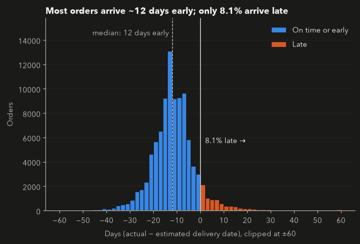
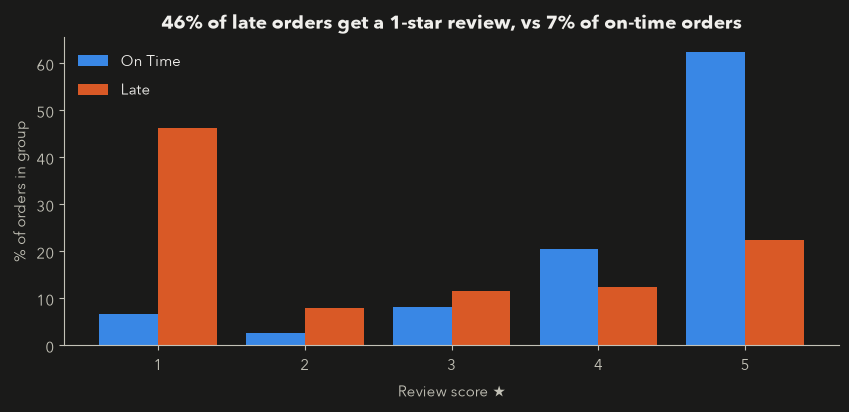
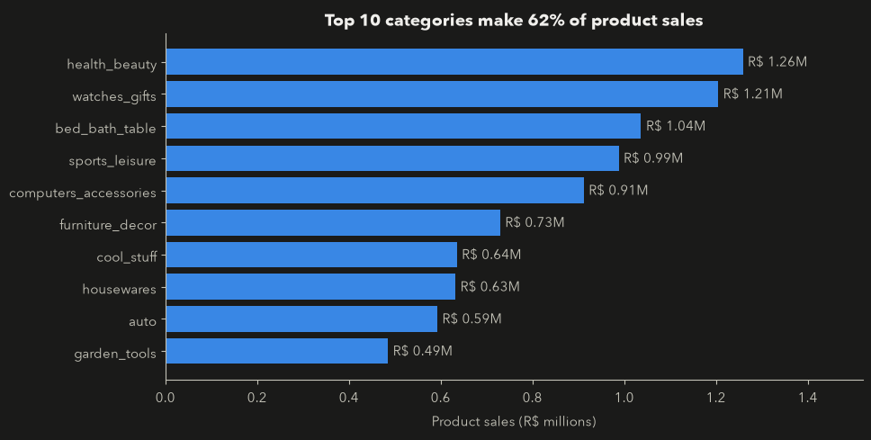
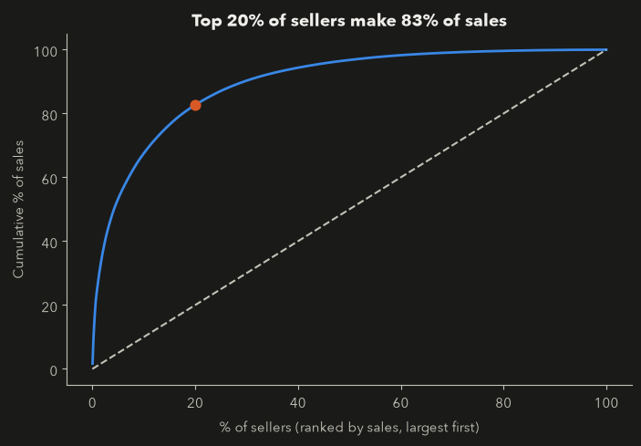

# E-Commerce Decision Intelligence Platform

**Where does a marketplace's money come from, and what do late deliveries cost it?** An end-to-end analysis of about 99,000 Brazilian e-commerce orders: a relational PostgreSQL database, SQL business analysis, and Python analysis, with a Tableau dashboard and a late-delivery prediction model to follow.


## At a glance

| Orders | Customer payments | Avg. order value | Late deliveries | Repeat customers | Sellers |
|:---:|:---:|:---:|:---:|:---:|:---:|
| 99,441 | R$16.0M | R$160.99 | 8.1% | 3.1% | 3,095 |

*Sept 2016 to Oct 2018, all money in Brazilian reais (R$).*

## Key findings

- **Delivery is reliable, and estimates are cautious.** 8.1% of delivered orders arrive late; the median order arrives about 12 days *before* its estimated date.
- **Late delivery goes with bad reviews.** 46% of late orders get a 1-star review, against 7% of on-time orders. This is an association, not proof that lateness causes low scores.
- **A few categories carry the sales.** The top 10 of 74 product categories make up 62% of product sales. Among them, `bed_bath_table` has the most orders but the lowest average review (3.97 vs 4.09 overall).
- **A small group of sellers drives the marketplace.** The top 20% of sellers make about 83% of product sales, and 130 of 3,095 sellers make half.
- **Few customers return.** Only 3.1% of customers (2,997 of 96,096) bought more than once, but those who did spent about twice as much (R$315 vs R$162 per customer).

<table>
  <tr>
    <td width="50%"><br><sub>Most orders arrive well before the estimated date.</sub></td>
    <td width="50%"><br><sub>Late orders are far more likely to get 1 star.</sub></td>
  </tr>
  <tr>
    <td width="50%"><br><sub>The top 10 categories make up 62% of product sales.</sub></td>
    <td width="50%"><br><sub>The top 20% of sellers make about 83% of sales.</sub></td>
  </tr>
</table>

## The business problem

A marketplace sells through thousands of independent sellers. Management wants to know:

- Where does the money come from, and how is it changing?
- Which product categories and sellers matter most?
- How reliable is delivery, and does it affect customer satisfaction?
- Do customers come back?

## Data

The **Olist Brazilian E-Commerce Public Dataset**, published by Olist on [Kaggle](https://www.kaggle.com/datasets/olistbr/brazilian-ecommerce): about 99,000 orders across nine related tables (customers, orders, order items, payments, reviews, products, sellers, category translations, geolocation). The raw files are not stored in this repository; see the dataset page for its license and terms.

The table relationships are documented in the [ER diagram](docs/erd.md).

## How the analysis was done

- **Grain first.** An order can have several payments, items, and reviews, so each table is reduced to one row per order before joining. Row counts are checked after every join.
- **Clear metric definitions.** Customer payment value (`payment_value`) and product sales (`price`, excluding freight) are kept separate. Repeat customers are identified with `customer_unique_id`, not `customer_id`.
- **Late means delivered after the estimated date.** Undelivered orders are never counted as on time.
- **Latest review per order.** Where an order has several reviews, the most recent one is used (a SQL window function), so every score is one a customer actually gave.
- **Data limits.** Months at the edges of the dataset (late 2016, September to October 2018) contain very few orders and are not treated as real trends.

## Repository structure

```text
ecommerce/
├── sql/
│   ├── schema.sql          # table definitions, keys and relationships
│   ├── load_data.sql       # loads the CSV files with psql \copy
│   └── analysis.sql        # 13 business questions in SQL
├── notebooks/
│   ├── 01_business_analysis.ipynb    # delivery, reviews, categories, sellers
│   ├── 02_customer_analysis.ipynb    # planned: repeat customers, RFM
│   └── 03_delivery_prediction.ipynb  # planned: late-delivery model
├── scripts/download_data.py          # reproducible data download
├── docs/                             # ER diagram and project specification
├── images/                           # charts used in this README
├── dashboard/                        # planned: Tableau dashboard
└── requirements.txt
```

## Reproduce it

You need Python 3.11 or newer and PostgreSQL. The notebooks connect to a local database named `ecommerce` without a password, as with a default Postgres.app setup.

```bash
# 1. Python environment
python3 -m venv .venv
source .venv/bin/activate
pip install -r requirements.txt

# 2. Download the raw CSV files into data/raw/
python scripts/download_data.py

# 3. Create and load the database (run from the project root)
createdb ecommerce
psql -d ecommerce -f sql/schema.sql
psql -d ecommerce -f sql/load_data.sql
```

Then open `notebooks/01_business_analysis.ipynb` and run all cells, or run `sql/analysis.sql` in `psql`.

## Roadmap

- [x] Repository setup and reproducible data download
- [x] PostgreSQL schema, data loading, and ER diagram
- [x] SQL business analysis (13 questions)
- [x] Python analysis: delivery, reviews, categories, seller concentration
- [ ] Customer analysis: repeat behaviour and RFM segments
- [ ] Tableau executive dashboard
- [ ] Late-delivery classification model (using only information known before delivery)
- [ ] Final recommendations

## Tools

PostgreSQL, SQL, Python (pandas, matplotlib, SQLAlchemy), Jupyter, Tableau (planned), scikit-learn (planned), Git and GitHub.
