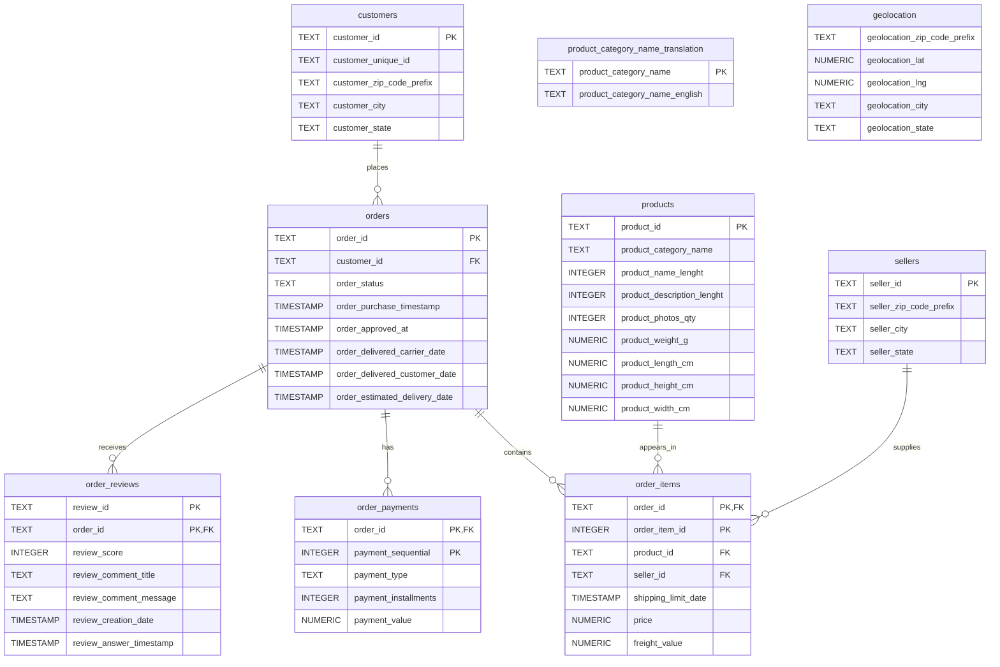

# E-Commerce Database ERD

## Relationship Summary

- One customer can place many orders through `orders.customer_id`.
- One order can contain many order items through `order_items.order_id`.
- One product can appear in many order items through `order_items.product_id`.
- One seller can supply many order items through `order_items.seller_id`.
- One order can have many payment records through `order_payments.order_id`.
- One order can have many review records through `order_reviews.order_id`.

`order_items` uses the composite primary key `(order_id, order_item_id)`. `order_payments` uses `(order_id, payment_sequential)`, and `order_reviews` uses `(review_id, order_id)`.

`product_category_name_translation` and `geolocation` are intentionally shown without relationship lines because the current schema does not declare foreign keys for them. Geolocation is not linked by a foreign key because `geolocation_zip_code_prefix` is not treated as a unique key and can have multiple coordinate observations.
